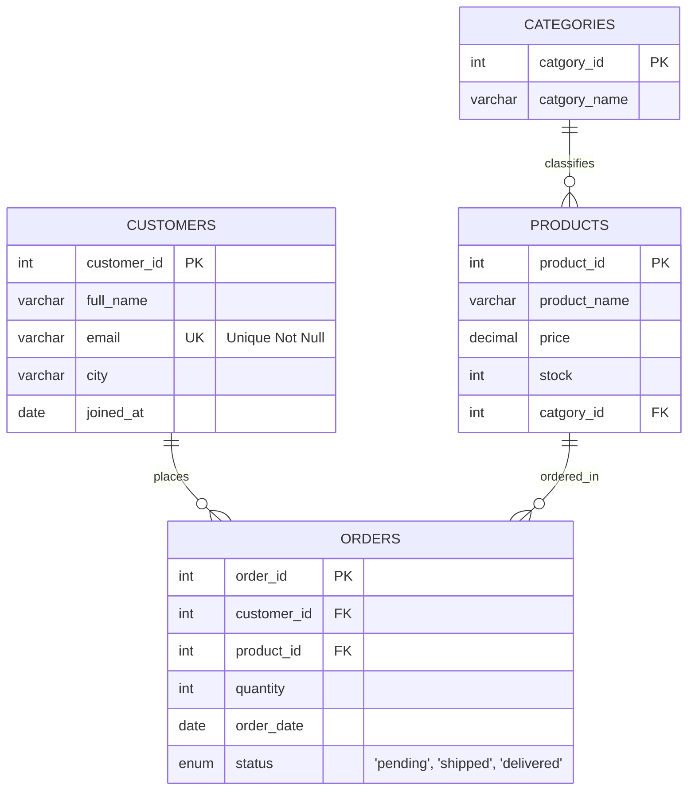

# 🛒 E-Commerce Relational Database Architecture & Query Foundations (MySQL)

[](https://www.mysql.com/)
[]()
[]()
[](https://islamyasser424-design.github.io/portfolio-/)

> **A foundational MySQL implementation modeling an end-to-end retail e-commerce database (`online_store`): creating relational schemas with foreign key integrity, managing schema evolution via `ALTER TABLE`, populating transactional seed datasets, and executing pattern-matching and aggregate queries.**

---

## 📌 Table of Contents
- [✨ Business Scenario](#-business-scenario)
- [📐 Entity-Relationship Architecture](#-entity-relationship-architecture)
- [🏗️ Schema Definitions (DDL)](#️-schema-definitions-ddl)
- [📦 Seed Dataset (DML)](#-seed-dataset-dml)
- [🔍 Assessment Solutions & Query Walkthrough](#-assessment-solutions--query-walkthrough)
  - [Q1: Pattern Matching — Second Letter Wildcard (`LIKE '_a%'`)](#q1-pattern-matching--second-letter-wildcard-like-_a)
  - [Q2: Financial Filtering — High-Value Inventory (`price > 500`)](#q2-financial-filtering--high-value-inventory-price--500)
  - [Q3: Transactional Metric Aggregation (`COUNT`, `MIN`, `MAX`)](#q3-transactional-metric-aggregation-count-min-max)
- [🚀 Execution Guide](#-execution-guide)
- [👤 Author & Connect](#-author--connect)

---

## ✨ Business Scenario

An emerging e-commerce platform requires a robust transactional database (`online_store`) to capture customer account registrations, categorize inventory items, and log customer order fulfillment stages (`pending`, `shipped`, `delivered`). The operational team requires data pipelines to audit customer naming patterns, identify high-ticket inventory, and summarize total order batch sizes.

---

## 📐 Entity-Relationship Architecture



---

## 🏗️ Schema Definitions (DDL)

```sql
CREATE DATABASE online_store CHARACTER SET utf8mb4 COLLATE utf8mb4_unicode_ci;
USE online_store;

-- Customers Entity
CREATE TABLE customers (
    customer_id INT AUTO_INCREMENT PRIMARY KEY,
    full_name VARCHAR(100) NOT NULL,
    city VARCHAR(50),
    joined_at DATE
);

-- Schema Evolution: Add email with unique constraint
ALTER TABLE customers ADD email VARCHAR(150) UNIQUE NOT NULL AFTER full_name;

-- Categories Entity
CREATE TABLE catgories (
    catgory_id INT PRIMARY KEY AUTO_INCREMENT,
    catgory_name VARCHAR(80) NOT NULL
);

-- Products Entity
CREATE TABLE products (
    product_id INT PRIMARY KEY AUTO_INCREMENT,
    product_name VARCHAR(120) NOT NULL,
    price DECIMAL(10, 2) NOT NULL,
    stock INT DEFAULT 0,
    catgory_id INT,
    FOREIGN KEY (catgory_id) REFERENCES catgories(catgory_id)
);

-- Orders Entity
CREATE TABLE orders (
    order_id INT PRIMARY KEY AUTO_INCREMENT,
    customer_id INT NOT NULL,
    product_id INT NOT NULL,
    quantity INT NOT NULL,
    order_date DATE,
    status ENUM('pending', 'shipped', 'delivered') DEFAULT 'pending',
    FOREIGN KEY (customer_id) REFERENCES customers(customer_id),
    FOREIGN KEY (product_id) REFERENCES products(product_id)
);
```

---

## 🔍 Assessment Solutions & Query Walkthrough

### Q1: Pattern Matching — Second Letter Wildcard (`LIKE '_a%'`)
**Objective:** Identify all registered customer profiles whose second character in their name is `'A'` or `'a'`.
```sql
SELECT 
    customer_id,
    full_name,
    email,
    city
FROM customers
WHERE full_name LIKE '_a%' OR full_name LIKE '_A%';
```
#### Output:
| customer_id | full_name | email | city |
|:---:|:---|:---|:---|
| **2** | Sara Hassan | sara@mail.com | Alexandria |

*Technical Note:* In MySQL's pattern engine, `_` represents exactly one single character, while `%` represents zero or more characters. Combining `_a%` ensures exact positional filtering.

---

### Q2: Financial Filtering — High-Value Inventory (`price > 500`)
**Objective:** Extract all products with a retail listing price strictly exceeding $500.00 EGP.
```sql
SELECT 
    product_id,
    product_name,
    price,
    stock
FROM products
WHERE price > 500.00
ORDER BY price DESC;
```
#### Output:
| product_id | product_name | price | stock |
|:---:|:---|:---:|:---:|
| **1** | Laptop Pro | 15000.00 | 10 |
| **4** | Jeans Classic | 650.00 | 40 |

---

### Q3: Transactional Metric Aggregation (`COUNT`, `MIN`, `MAX`)
**Objective:** Calculate operational summary metrics: total unique orders logged, minimum unit volume, and maximum units ordered.
```sql
SELECT 
    COUNT(DISTINCT order_id) AS total_orders,
    MIN(quantity) AS min_quantity_ordered,
    MAX(quantity) AS max_quantity_ordered
FROM orders;
```
#### Output:
| total_orders | min_quantity_ordered | max_quantity_ordered |
|:---:|:---:|:---:|
| **8** | 1 | 3 |

---

## 🚀 Execution Guide

```bash
# Clone the repository
git clone https://github.com/islamyasser424-design/SQL-Quiz-1.git
cd SQL-Quiz-1

# Run the complete script via MySQL CLI
mysql -u root -p < SQL_Quiz_01_ECommerce_Foundations.sql
```

---

## 👤 Author & Connect

* **Author:** Islam Yasser — *Data Analyst & Business Intelligence Specialist*
* **Portfolio:** [islamyasser424-design.github.io/portfolio-/](https://islamyasser424-design.github.io/portfolio-/)
* **LinkedIn:** [linkedin.com/in/islam-yasser-55048b378](https://www.linkedin.com/in/islam-yasser-55048b378/)
* **GitHub:** [github.com/islamyasser424-design](https://github.com/islamyasser424-design)